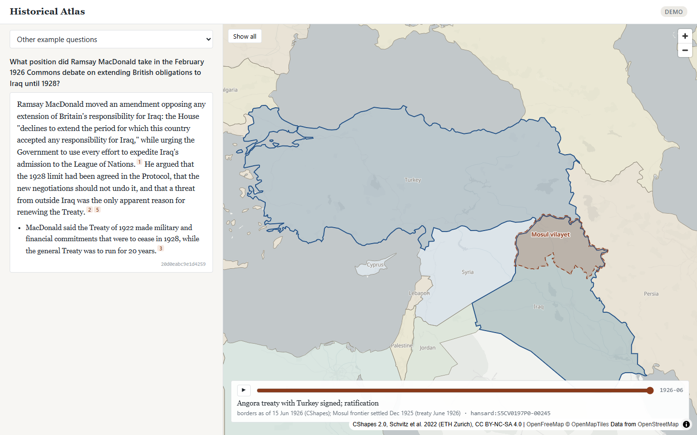

# Historical Atlas

Grounded question answering over 5,082 British parliamentary speeches (Hansard, Commons and Lords) and 15 FRUS
documents on five League of Nations disputes, 1920-1926: Aaland Islands, Upper Silesia, Vilna, Mosul and the
Greco-Bulgarian incident. Every claim in an answer cites a retrieved passage. When the corpus has no evidence, the system
returns `insufficient_evidence` instead of answering from model memory. A map shows the dated borders and dispute areas
for each answer.

Demo: https://huggingface.co/spaces/JBarens310/historical-atlas. It runs in static demo mode and replays real pipeline
outputs; live questions run locally (see below).



## Results (held-out test)

The test split was opened once, on frozen pipeline commit `8c282a9`, after predictions were written down.
Details: [docs/benchmarks/final_test.md](docs/benchmarks/final_test.md).

| Metric | Test | Release threshold |
|---|---|---|
| Correctness (20 answerable items, Sonnet judge) | 0.80 (bootstrap 95% CI 0.68-0.93) | >= 0.64 |
| Faithfulness (claims supported) | 0.98 (61/62) | reported, not gated |
| Retrieval R@20 (hybrid) | 0.775 | zero-tolerance gate on dev |
| Latency p50 / p95 | 3.9 s / 5.4 s | p95 <= 7.0 s |
| Cost per question | about $0.012 (deployed config, measured on dev) | reported |

Retrieval is the ceiling, not generation. On the dev run that chose the deployed config (rerank top 20), every question
whose labelled passage reached the top 5 got an at least partially correct answer (19/19). When the passage was missed,
the system declined in all 6 cases, with no hallucinated answer. On test, 6 of the 8 failed answerable items are
retrieval misses.

## Architecture

```
request (question + history)
  -> rewrite/route     Haiku makes a standalone query from history and flags calculation follow-ups
  -> hybrid retrieval  BM25 + nomic-embed-text-v1.5 (exact), depth 100 each, fused with RRF k=60
  -> rerank            Haiku orders the RRF top 20; top 5 chunks go to the generator
  -> generate          Haiku, strict grounding, per-claim chunk citations, output validated in code
     or tool           adjust_for_inflation (ONS CDKO series), executed by code, max 2 tool rounds
  -> response          answered | insufficient_evidence | needs_clarification, plus a JSONL trace
```

Backend: FastAPI (`backend/main.py`, `backend/pipeline.py`). Frontend: React + MapLibre (`frontend/`).
Design record: [ADR-001](docs/adr/ADR-001-current-architecture.md) to [ADR-005](docs/adr/ADR-005-generation.md).

## How it is evaluated

- Eval set: 106 items (answerable, out-of-corpus, ambiguous, follow-up, calculation, cross-case). Each answerable item
  is labelled with a verbatim passage checked against the source. Method: [eval/evaluation_methodology.md](eval/evaluation_methodology.md).
- Split dev / validation / test by question cluster, so near-duplicates never cross sets. Clusters come from
  BAAI/bge-small-en-v1.5, deliberately a different model than the retriever.
- The LLM judge is calibrated against my own grading. The first version agreed on 5/10 (too harsh on honest partial
  answers), so the rubric was rewritten; a judge is only used once it matches manual grading on at least 8/10.
- CI ([docs/benchmarks/ci_gate.md](docs/benchmarks/ci_gate.md)):
  - every push: 65 mocked tests plus hybrid R@20 on dev against a stored baseline, zero tolerance (deterministic, $0);
  - an LLM-contract job hashes prompts, model names and tool schemas; any change fails CI until a full eval passes
    and is recorded;
  - full eval (manual): correctness >= 0.64 and p95 <= 7.0 s block a release.

## Key decisions

| Decision | Reason | Evidence |
|---|---|---|
| BM25 over Postgres FTS for the lexical side | FTS with AND returned nothing for 25/26 dev questions; OR-ed FTS ranked worse than BM25 | [ADR-002](docs/adr/ADR-002-hybrid-retrieval.md), [baseline_lexical](docs/benchmarks/baseline_lexical.md) |
| Rerank top 20, not 50 | correctness -0.04 on dev (one question) for 41% lower cost and lower latency | [ADR-003](docs/adr/ADR-003-reranking.md) |
| Code-executed inflation tool | without it 3/12 calculations within 5%; with it 12/12 | [ADR-004](docs/adr/ADR-004-agent-architecture.md) |
| No free agent loop | an agent could skip search and answer from training data, which breaks grounding silently | [ADR-004](docs/adr/ADR-004-agent-architecture.md) |
| Containment over injection detection | a detector would flag normal history questions and does not see retrieved documents | [security_review](docs/security_review.md) |
| Structured JSONL logs, no OpenTelemetry/Langfuse | one instance; one file traces every stage | [observability](docs/benchmarks/observability.md) |
| CShapes 2.0 for borders | dated state borders, so the map shows borders as of each moment | [frontend README](docs/frontend/README.md) |

## Limitations

- Most eval questions were AI-generated from passages, which flatters retrieval (construction bias). A held-out test
  stops tuning overfit, not this.
- Small test set: n=20 answerable items, hence the wide interval.
- Two test items labelled out-of-corpus turned out to be answerable from the corpus (q061, q106).
- The security attack set (16 attacks, 4 benign look-alikes) was AI-drafted. 14/16 passed. A planted false fact in a
  document was repeated with a citation: containment stops instructions in documents, not false information.
- Dispute areas are approximate, built from modern districts and governorates.
- CShapes does not code the June 1922 Upper Silesia partition and puts Mosul in Iraq from 1920; both are drawn as
  hatched disputed areas instead.
- The hosted demo is static: it replays recorded answers and takes no new questions.
- Rate limits and the daily spend cap are in memory on one instance; a restart resets them.

## Run locally

Needs `uv`, Node and an `ANTHROPIC_API_KEY` (in the environment or `.env`).

```bash
cd frontend && npm ci && npm run build && cd ..
uv run -q --with anthropic --with python-dotenv --with fastembed --with numpy --with rank-bm25 --with fastapi \
  --with 'uvicorn[standard]' uvicorn main:app --app-dir backend --port 8000
# dev UI with hot reload (proxies /api to :8000): cd frontend && npm run dev
```

Optional env vars: `INVITE_CODES_SHA256` (comma-separated `label:sha256hex`; create with
`uv run python backend/scripts/make_invite_code.py <label>`), `DAILY_SPEND_CAP_USD` (default 2.00),
`RATE_LIMIT_PER_MIN` (5), `RATE_LIMIT_PER_DAY` (50), `ALLOWED_ORIGINS`, `OBS_LOG_PATH`.
Without `INVITE_CODES_SHA256` the app runs in demo mode only.

Deploy: the `Dockerfile` builds the frontend and bakes in the embedding model (Hugging Face Docker Space, port 7860;
check `/api/health`). The static demo Space is built with `python3 deploy/build_static_space.py` into
`deploy/static_space/`.

## How it was built

Built as a coached engineering practicum. Nearly all code was AI-generated with Claude Code. The design, evaluation and
release decisions were mine; they are recorded in [docs/adr](docs/adr) and [docs/benchmarks](docs/benchmarks).

## Data and licences

- Hansard (UK Parliament debates): contains Parliamentary information licensed under the Open Parliament Licence v3.0.
- FRUS, Foreign Relations of the United States (US Department of State, Office of the Historian): public domain.
- ONS series CDKO (Retail Prices Index, long-run series from 1800, Jan 1974 = 100; used by the inflation tool): Open Government Licence v3.0.
- Country borders: CShapes 2.0, Schvitz et al. 2022 (ETH Zurich), CC BY-NC-SA 4.0; the derived borders file is shared
  under the same licence.
- Dispute areas: Natural Earth (public domain) for Aaland and Mosul; geoBoundaries/OSM (ODbL) for Upper Silesia and
  Vilna; geoBoundaries (public domain) for Petrich.
